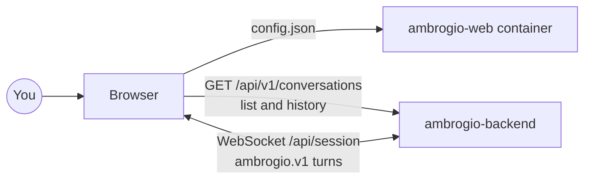

<p align="center">
  
</p>

# Ambrogio web chat

**Ambrogio**: talk to it like Alexa, chat with it like ChatGPT. One self-hosted AI assistant for your whole homelab. Multi-agent by design: each agent you configure handles one job, such as the house, music, weather or your documents, using the services you already host.

This repository is its **web chat client**: an optional browser interface for talking to an Ambrogio backend, as an alternative to the terminal client.

| Repository | Role |
|---|---|
| [ambrogio-backend](https://github.com/ambrogio-app/ambrogio-backend) | Conversation server, agents, speech, storage, public protocol |
| [ambrogio-cli](https://github.com/ambrogio-app/ambrogio-cli) | Terminal chat client |
| [ambrogio-satellite](https://github.com/ambrogio-app/ambrogio-satellite) | Voice satellite with wake word, microphone and speaker |
| **ambrogio-web** (this one) | Optional web chat client |

> Ambrogio is in early development.

## How it works

The page lists your conversations on the left and shows the open one on the right, with a field to write in. The backend stores every conversation, so a chat started from the terminal or a voice satellite can go on here, and the other way round. Answers stream in as the backend produces them and are shown as Markdown.



- The container serves only static files. The browser talks to the backend directly, so the backend must allow the origin of this page in its HTTP component (`allowedOrigins`).
- The page reads `config.json` next to `index.html` when it opens. The file is not in the image: you mount it.
- The browser identifies itself as `web-<random UUID>`, kept in the browser's local storage.

The client uses only the public interfaces of the backend: the `ambrogio.v1` protocol and the HTTP API. Their contracts are in the model of `ambrogio-backend`.

## Configuration

`config.json`:

```json
{
  "backendUrl": "https://ambrogio.example.com",
  "language": "en"
}
```

| Field | Required | Meaning |
|---|---|---|
| `backendUrl` | yes | Absolute HTTP(S) base URL of the backend, without credentials, query or fragment |
| `language` | no | Interface language, `it` or `en`. Without it the page follows the browser, with English as fallback |

Any other field makes the configuration invalid, and the page shows the reason.

## Run with Docker

```bash
docker run -d --name ambrogio-web -p 8080:8080 \
  -v "$PWD/config.json:/usr/share/nginx/html/config.json:ro" \
  ghcr.io/ambrogio-app/ambrogio-web:<version>
```

The container listens on port 8080 as an unprivileged user. HTTPS belongs to your reverse proxy.

## Development

You need Node.js 24 or later and pnpm 12.11.2 (the version in `packageManager`).

```bash
pnpm install --frozen-lockfile
cp config.example.json public/config.json   # then set backendUrl
pnpm dev
```

| Command | What it does |
|---|---|
| `pnpm typecheck` | TypeScript check |
| `pnpm test` | Unit and interface tests with a simulated backend |
| `pnpm build` | Static files in `dist/` |
| `pnpm test:backend` | Integration test against the `ambrogio-backend` checkout next to this repository, or in `AMBROGIO_BACKEND_REPO`, built with `pnpm build`, through the backend's public test entry point, with the PostgreSQL test server in `AMBROGIO_TEST_DATABASE_URL` (start it with `../ambrogio-model/scripts/test-postgres start` and export the line it prints); it logs the backend commit it used |
| `node scripts/verify-docker-image.mjs <image>` | Checks a built image: labels, user, port, headers and cache |

The code is organised by feature in `src/features/` (`configuration`, `session`, `conversations`, `chat`), each with a pure `model/` and a React `ui/`; shared code is in `src/shared/` and `src/app/` wires the features together.

## Engineering model

Requirements, contracts and verifications live in [`system-model/`](system-model/) and are managed with [Reqvire](https://reqvire.org/). They are part of the single Ambrogio model, checked from a workspace folder that holds this repository next to `ambrogio-model` and the other product repositories; see `ambrogio-model` for the Reqvire version and the model checks. Read them before changing behaviour.

## License

[MIT](LICENSE)
